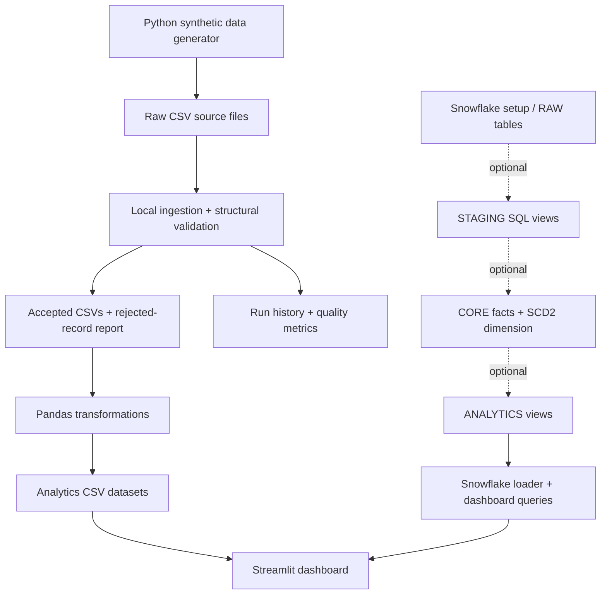

# SupplyChainIQ — Supply Chain Data Engineering Platform

> **Portfolio project using synthetic data.** It is not affiliated with Logitech and does not use proprietary Logitech data.

SupplyChainIQ demonstrates a local and optional Snowflake data engineering workflow: deterministic source generation, CSV ingestion, schema/business validation, referential checks, duplicate handling, lineage, Pandas transformations, analytics outputs, a Streamlit dashboard, automated tests, and account-ready Snowflake loading/modeling assets.

## Business problem
Supply-chain teams need reliable visibility into order/revenue trends, warehouse stock risk, delivery performance and supplier lead times. This project models those workflows with generated data and makes rejected records and pipeline execution history inspectable rather than silently cleaning errors.

## Architecture


**Implemented:** local CSV generation, ingestion, validation, deduplication, transformations, reports, dashboard, Snowflake staged loading (`PUT`/`COPY INTO`), SQL modeling, dashboard query routing, unit tests and CI configuration. Snowflake requires an account and manual provisioning; it has not been live-validated here. Streams/Tasks are an optional pattern and require review and privileges before activation.

## Stack
- Python 3.11+ (local test run uses Python 3.12)
- Pandas and NumPy; SQL for warehouse modeling
- Streamlit and Plotly dashboard
- Snowflake Connector/Snowpark optional dependencies
- Pytest, Ruff, Docker, GitHub Actions

## Repository map
```text
src/supplychainiq/       generator, config, ingestion, validation, transforms, pipeline
streamlit_app/           business dashboard
sql/                     Snowflake setup, RAW, staging, core, analytics, monitoring, optional tasks, queries
tests/unit/              local pipeline and validation tests
data/raw/                generated source CSVs (gitignored)
data/processed/          accepted data and analytics outputs (gitignored)
data/reports/            run history and rejected-record reports (gitignored)
docs/                    architecture, model, data dictionary, setup and troubleshooting
```

## Run it on your computer

The local workflow needs Python 3.11 or newer and does not require Snowflake credentials.

1. Create a virtual environment from the project directory:

   ```powershell
   python -m venv .venv
   .venv\Scripts\Activate.ps1
   ```

   On Linux or macOS, activate it with `source .venv/bin/activate`.

2. Install the application and test dependencies:

   ```text
   python -m pip install -e ".[app,test]"
   ```

3. Generate synthetic data, validate and ingest records, create analytics outputs, and write monitoring reports:

   ```text
   python -m supplychainiq.pipeline
   ```

4. Launch the local dashboard:

   ```text
   streamlit run streamlit_app/app.py
   ```

5. Run the tests:

   ```text
   pytest -q
   ```

   The test suite includes local pipeline and mocked Snowflake tests.

The pipeline command writes generated source files, accepted data, rejection reports, analytics outputs, and an append-only JSONL run record. To ingest existing raw files without regenerating them, run `python -m supplychainiq.pipeline --no-generate`. Change the generated order count and seed with `--orders 5000 --seed 42`.

The deterministic generator preserves intentionally invalid records, including negative quantities and inventory, an invalid delivery date, an unknown customer reference, and a duplicate order. Accepted and rejected outputs make validation and deduplication visible. Local ingestion is repeat-safe for business keys: it replaces each accepted output snapshot and deduplicates source business keys, while run history remains append-only.

## Data sources
The generator creates `orders.csv`, `order_items.csv`, `products.csv`, `customers.csv`, `warehouses.csv`, `inventory.csv`, `suppliers.csv`, `purchase_orders.csv`, and `shipments.csv`. Data is simulated, reproducible from a seed, and configurable by order count.

## Data modeling
- `FACT_ORDERS`: one row per order item; revenue = quantity × unit price.
- `FACT_INVENTORY_SNAPSHOT`: one row per product/warehouse/snapshot date.
- `FACT_SHIPMENTS`: one row per shipment.
- `FACT_PURCHASE_ORDERS`: one row per purchase-order item in this simplified source model.
- `DIM_PRODUCT`: SCD Type 2 example using a surrogate key, business key, effective timestamps, current flag and attribute hash. Historical attributes remain available after changes.

Snowflake SQL lives under `sql/` and is ordered by directory prefix. The Python loader executes the staging, core, analytics and monitoring assets as a batch after the RAW schema and stage are provisioned.

## Snowflake setup (optional)
1. Provision a Snowflake account and a role with the privileges needed to create/use a warehouse, database, schemas, internal stage, tables, views, and tasks as applicable.
2. Install the optional dependencies: `python -m pip install -e ".[app,test,snowflake]"`.
3. Copy `.env.example` to `.env` and set account, user, warehouse, database/schema, and password or private-key path. Keep credentials out of source control. The bootstrap SQL defaults to `SUPPLYCHAIN_DB`; if using another database name, adapt the bootstrap SQL and stage/file-format settings consistently.
4. As an appropriately privileged role, execute `sql/00_setup/001_create_environment.sql`, `sql/01_raw/001_raw_tables.sql`, and `sql/01_raw/002_stage_and_copy_into.sql` in that order. The setup script creates an XSMALL warehouse initially suspended with auto-suspend; confirm account cost/privileges before running it. The optional manual upload/COPY examples are in `sql/01_raw/003_manual_copy_examples.sql`.
5. Set `SUPPLYCHAINIQ_BACKEND=snowflake` in `.env`, then run `python -m supplychainiq.pipeline --backend snowflake`. The pipeline generates and locally validates the sample files, uploads all nine raw CSVs to the internal stage, uses `COPY INTO` with batch/file metadata, and runs staging views, dimensions, SCD Type 2, incremental `MERGE` fact loads, analytics views and monitoring.
6. Run `streamlit run streamlit_app/app.py` to use the Snowflake-backed dashboard. It queries analytics views and monitoring data instead of local CSV outputs.
7. Review `sql/06_tasks_streams/001_incremental_pattern.sql` before manually creating or resuming its optional task. It is not auto-activated.

The integration is implemented and covered by mocked tests but cannot be certified against a live account until credentials, privileges, and account-specific behavior are tested. The local CSV workflow remains usable with `SUPPLYCHAINIQ_BACKEND=local`.

## Quality and monitoring
The quality score is `100 × (1 − rejected source rows / total source rows)`, bounded by the observed counts; duplicate rows deduplicated are separately reported and are not included as validation rejects. Structural missing-column errors fail the file; row-level rule failures are sent to a rejection CSV with a reason. Reports include source filename, batch ID, ingestion timestamp and SHA-256 file hash. This is a record-based score, not a guarantee that all business logic is correct.

## Docker
```bash
cp .env.example .env
docker compose up --build
```
Then open the Streamlit port 8501 on your machine. The default image supports local mode. To include Snowflake dependencies, set `INSTALL_SNOWFLAKE=true` in the shell or `.env` before rebuilding (PowerShell: `$env:INSTALL_SNOWFLAKE = "true"`), and configure Snowflake values in `.env`. The image starts the dashboard; run the pipeline from its button or run a one-off command with the same image.

## CI and tests
GitHub Actions installs the package, runs Ruff and Pytest, and builds the Docker image. Tests cover deterministic generation, schema and row validation, referential checks, ingestion, duplicate handling, transformation outputs, and mocked Snowflake uploads and model execution. To run locally: `pytest -q` and `ruff check src tests streamlit_app`.

## Business questions / SQL
`sql/business_queries/001_business_questions.sql` includes queries for monthly revenue, top products, warehouse inventory, stockout risk, on-time delivery, supplier lead time, late shipments, fulfillment duration, supplier ranking, month-over-month growth, category revenue and data-quality trends. These target the declared Snowflake table/view contracts; run after the corresponding modeled tables have been populated.

## Job-description alignment
| Skill area | Project evidence |
|---|---|
| Python/Pandas | Generator, ingestion, validations and reusable transformations |
| SQL/data modeling | Raw/staging/core/analytics SQL, facts/dimensions and SCD2 pattern |
| Snowflake | Environment, RAW schema, connector helper, staging/views, Streams/Tasks example |
| Data quality | Schema checks, row rules, rejection reasons, report score and tests |
| Monitoring | Batch IDs, file hashes, run history, counts and quality status |
| Business communication | Streamlit KPIs and interactive charts |
| Engineering practices | Package structure, env configuration, Docker and GitHub Actions |

## Known limitations / next steps
- Live Snowflake account validation, privileges, query behavior, COPY results, Streams/Tasks activation, and account-specific costs remain unverified because no account is provisioned.
- Supplier receipt dates are currently mostly blank, so actual supplier lead-time metrics need a populated receipt-date source.
- The local dashboard has real outputs but is not yet a production multi-user application.
- Consider alert delivery and an orchestration service only when operational needs justify them.

## What's included
| Component | Status |
|---|---|
| Synthetic data generation, CSV ingestion, batch tracking, and rejection reports | Implemented |
| Pandas transformations and revenue, inventory, and shipment analytics | Implemented |
| Local Streamlit dashboard | Implemented and browser-checked |
| Snowflake staged loading, SQL modeling, and dashboard queries | Implemented; mocked tests pass; live account validation pending |
| SCD Type 2 SQL pattern and Streams/Tasks example | Implemented; task remains opt-in and account validation pending |
| Docker configuration and GitHub Actions CI workflow | Implemented; local image build and remote CI validation pending |
| Automated tests | Local and mocked integration tests; run `pytest -q` |

The local pipeline is functional and the Snowflake path is wired end to end in code, but this repository is not a deployed or live-validated production Snowflake platform. Describe warehouse integration as implemented but account validation as pending until it has been run against a provisioned account.

### Recommended next priority: live validation
Provision a Snowflake account, execute the setup steps above, run a generated batch, reconcile row counts and rejected records, test SCD2 with a changed product, and verify dashboard queries and incremental processing.
